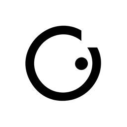

# NOVA Drop

<p align="center">
  
</p>

<p align="center">
  <strong>Your files. Your devices. Your network.</strong><br />
  High-speed, privacy-first local file transfer application across Windows, iOS, and Android.
</p>

<p align="center">
  <a href="https://github.com/patilomkar7570/NOVA-Drop/releases/tag/v1.0.0"></a>
  <a href="https://github.com/patilomkar7570/NOVA-Drop"></a>
  
  
  
</p>

---

## Overview

**NOVA Drop** is an ultra-fast, local-first file transfer application built for instant file sharing between your PC, phone, and tablet over your local Wi-Fi network. It operates without cloud storage, third-party relays, user accounts, or file compression.

Whether transferring original 4K video clips, high-resolution RAW photos, large folders, or documents, NOVA Drop transfers original bytes with cryptographic SHA-256 verification and line-rate local Wi-Fi speed.

---

## Key Features

- **Privacy First**: Files stream directly through your local network. Zero external cloud storage, zero tracking, and zero telemetry.
- **Zero Compression**: 100% byte-for-byte fidelity. Media is never transcoded, recompressed, or downscaled. Original filenames, extensions, and metadata are preserved.
- **Full Folder & File Support**: Upload individual files or entire folders with nested directory structures using dedicated **Upload Files** and **Upload Folders** selectors.
- **Native Windows Desktop Window**: Runs as a true desktop application on PC — not as a website or browser tab. Opens in its own frameless window with custom application icon.
- **Automatic Localhost & Wi-Fi Server**: As soon as you open NOVA Drop on PC, the local engine immediately goes live on `0.0.0.0:3000` and automatically copies your Wi-Fi URL to your clipboard.
- **Multi-Platform Support**:
  - **Windows Desktop Application**: Standard Windows Setup Installer (`NOVA-Drop-Setup.exe`) that installs to your PC with Desktop & Start Menu shortcuts and instant one-click launch.
  - **Android (Native APK)**: Native application (`NOVA-Drop.apk`) with background transfers, quick-connect screen, and system `DownloadManager` integration.
  - **iOS (iPhone & iPad)**: High-performance Safari Web Edition with "Add to Home Screen" standalone PWA support.
- **Frictionless Pairing**: Simple 6-digit numeric pairing codes (`XXX-XXX`) and direct session links.
- **Brute-Force Shield**: In-memory rate limiting locks out unauthorized code guessing attempts automatically.
- **Adaptive Appearance**: Auto (System default) theme with high-contrast, calibrated Dark and Light themes.

---

## Downloads (Release v1.0.0)

| Package | Format | Description |
| :--- | :---: | :--- |
| **[NOVA-Drop-Setup.exe](https://github.com/patilomkar7570/NOVA-Drop/releases/download/v1.0.0/NOVA-Drop-Setup.exe)** | `.exe` (Installer) | **Windows Desktop Application.** Installs NOVA Drop on your PC with Start Menu & Desktop shortcuts, boxed application icon, and a dedicated **"Launch NOVA Drop"** button on completion. |
| **[NOVA-Drop.apk](https://github.com/patilomkar7570/NOVA-Drop/releases/download/v1.0.0/NOVA-Drop.apk)** | `.apk` (Android) | **Android Mobile App.** Connects over local Wi-Fi, receives original files to your phone's Downloads folder, and uploads files back to your PC. |

---

## Instant Transfer: How It Works

Whenever you open **NOVA Drop** on your PC, the local transfer engine **automatically goes live immediately**:

### Step 1: Open NOVA Drop on Your PC
- Launch NOVA Drop from your Desktop or Start Menu.
- The dedicated desktop application window opens instantly.
- The engine binds to your network and **automatically copies your local Wi-Fi URL** (e.g. `http://192.168.31.75:3000`) to your clipboard.

### Step 2: Open on Your Phone or Tablet
- Ensure your phone is connected to the same Wi-Fi network.
- **Android:** Open `NOVA-Drop.apk` on your phone and tap **Connect**.
- **iPhone / iPad / Mobile Browser:** Open Safari or Chrome and paste the URL (e.g. `http://192.168.31.75:3000`).

### Step 3: Transfer Files & Folders
- **Send:** Select individual files or entire folders (**Upload Files** or **Upload Folders**) and click **Create Transfer Session**.
- **Receive:** On the other device, enter the 6-digit code or tap the direct link, then click **Accept & Receive Items**.
- Files stream byte-for-byte directly over your local Wi-Fi with real-time percentage progress and cryptographic SHA-256 integrity verification.

---

## Developer Setup

### Prerequisites
- Node.js (v18, v20, or v22+)
- npm (v9+)

### Installation & Build

```powershell
# Clone the repository
git clone https://github.com/patilomkar7570/NOVA-Drop.git
cd NOVA-Drop

# Install dependencies
npm install

# Build client and server bundles
npm run build

# Start the application
npm start
```

### Running Automated Tests

```powershell
npm test
```

All 18 comprehensive engine and streaming security tests run via Vitest.

---

## License

MIT © [NOVA Software](https://github.com/patilomkar7570/NOVA-Drop).
